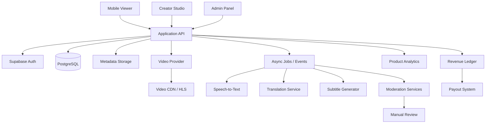
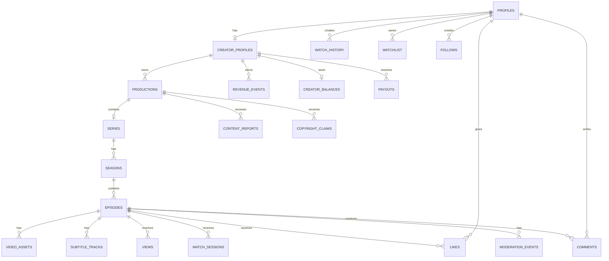
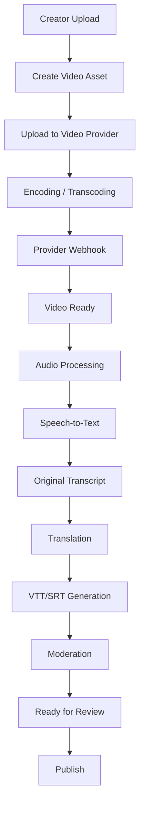

# Sıra Sende

> İzledin. Şimdi sıra sende.

Sıra Sende, bağımsız ve AI destekli creatorların dikey mini dizi ve kısa film yayınlayabildiği, izleyicilerin kısa bölümler halinde içerik tükettiği ve creatorların gelir elde ettiği **creator-driven vertical micro-drama streaming marketplace** platformudur.

Platform; mobil izleme deneyimini, creator ekonomisini, vertical discovery akışını ve AI destekli altyazı/lokalizasyon altyapısını bir araya getirir.

İlk pazar Türkiye, ilk desteklenen diller Türkçe ve İngilizcedir. Mimari, global creator ve izleyici büyümesine hazır tasarlanacaktır.

> Bu README, ürün, iş modeli ve teknik mimari için ana blueprint dokümanıdır. Mevcut repository başlangıç aşamasındaysa, aşağıdaki hedef mimari “Proposed” olarak değerlendirilmelidir.

---

## Table of Contents

- [Product Definition](#product-definition)
- [Vision and Positioning](#vision-and-positioning)
- [Target Users](#target-users)
- [Core User Experiences](#core-user-experiences)
- [Content Model](#content-model)
- [Localization Strategy](#localization-strategy)
- [Creator Studio](#creator-studio)
- [Business Model](#business-model)
- [Unit Economics](#unit-economics)
- [Architecture Decisions](#architecture-decisions)
- [Technical Blueprint](#technical-blueprint)
- [System Architecture](#system-architecture)
- [Data Model](#data-model)
- [Video Pipeline](#video-pipeline)
- [Moderation and Copyright](#moderation-and-copyright)
- [Security](#security)
- [Recommendation Strategy](#recommendation-strategy)
- [KPI Framework](#kpi-framework)
- [MVP Scope](#mvp-scope)
- [Non-Goals and V2 Scope](#non-goals-and-v2-scope)
- [Repository Structure](#repository-structure)
- [Environment Configuration](#environment-configuration)
- [Development Roadmap](#development-roadmap)
- [Current Status](#current-status)
- [Next Technical Milestone](#next-technical-milestone)
- [Open Decisions](#open-decisions)

---

## Product Definition

Sıra Sende, ReelShort, NetShort ve DramaBox gibi vertical micro-drama platformlarına alternatif olarak geliştirilen, aynı zamanda creatorların kendi yapımlarını yayınlayıp gelir elde edebildiği bir platformdur.

Ürünün gerçek tanımı:

> **Creator-driven vertical micro-drama streaming marketplace**

Sıra Sende yalnızca bir video hosting ürünü değildir. Üç temel sistemi birleştirir:

1. **Vertical Micro-Drama Streaming Platform**  
   İzleyicilerin kısa, dikey ve bölüm bazlı hikâyeler tükettiği mobil-first deneyim.
2. **Creator Economy Marketplace**  
   Bağımsız yapımcıların, küçük stüdyoların, sosyal medya creatorlarının ve AI video üreticilerinin içerik yayınlayıp gelir elde ettiği yapı.
3. **AI Localization Platform**  
   Video yüklemelerinden otomatik transcript, subtitle ve çeviri üreten lokalizasyon altyapısı.

### Marka Mesajları

Ana mesaj:

> İzledin. Şimdi sıra sende.

Alternatif mesajlar:

- Hikâyeni üret. Yayınla. Kazan.
- Şimdi senin hikâyen.
- Dizini üret. Yayınla. Kazan.

---

## Vision and Positioning

### Product Positioning

| Perspektif | Deneyim |
| --- | --- |
| İzleyici | ReelShort / NetShort benzeri kısa dizi izleme |
| Creator | YouTube Studio benzeri üretici paneli |
| Discovery | TikTok benzeri vertical swipe |
| İçerik yapısı | Netflix/ReelShort benzeri Series → Season → Episode |
| Gelir | Creator revenue sharing |
| Lokalizasyon | AI transcription, subtitle ve translation |

### Uzun Vadeli Vizyon

Sıra Sende yalnızca Türkçe kısa dizilerin yayınlandığı bir uygulama olmayacaktır. Hedef, Türkiye'de başlayan ancak global creatorların kendi micro-drama içeriklerini yayınlayabildiği uluslararası bir vertical storytelling marketplace oluşturmaktır.

> **Create locally. Watch globally.**

Örnek akış:

```text
Turkish Creator
    ↓
Turkish Production
    ↓
Automatic English Subtitle
    ↓
Global Discovery
    ↓
International Viewers
```

### İlk Pazar Stratejisi

İlk pazar:

- Türkiye

İlk creator grupları:

- AI video creatorları
- Bağımsız film yapımcıları
- TikTok ve Instagram creatorları
- Sinema ve iletişim öğrencileri
- Küçük production şirketleri

İlk hedef milyonlarca boş kullanıcı değil, kaliteli creatorlar ve izlenebilir güçlü bir katalog oluşturmaktır.

Örnek başlangıç hedefi:

- 20–50 aktif creator
- 50+ kaliteli micro-drama series
- Düzenli bölüm yayınlayan ilk creator topluluğu

---

## Target Users

### İzleyici

İzleyici:

- kısa dikey diziler keşfeder,
- bölümleri arka arkaya izler,
- dizileri takip eder,
- creatorları takip eder,
- içerikleri beğenir,
- yorum yapar,
- watchlist oluşturur,
- izleme geçmişine erişir,
- yeni bölüm bildirimleri alır,
- altyazı dili seçer.

Ana izleme formatı:

```text
9:16 vertical video
```

Önerilen bölüm süresi:

```text
30 saniye – 3 dakika
```

Tipik hedef:

```text
60–120 saniye
```

Bir series şu sayıda bölüm içerebilir:

- 10
- 20
- 50
- 100+
- Product configuration ile belirlenebilecek diğer sayılar

### Creator / Yapımcı

Creator türleri:

- Bağımsız film yapımcısı
- Sosyal medya içerik üreticisi
- Profesyonel production company
- Küçük stüdyo
- Öğrenci yapımcı
- AI içerik üreticisi
- İnsan + AI hibrit creator

Creator temel akışı:

```text
Creator
  → Create Production
  → Create Series
  → Create Season
  → Create Episode
  → Upload Video
  → AI Processing
  → Moderation
  → Review
  → Publish
```

---

## Core User Experiences

## Discover Mode

Discover, TikTok benzeri vertical swipe deneyimidir.

Kullanıcı şu içerikler arasında geçiş yapabilir:

- Yeni diziler
- Popüler bölümler
- Trending içerikler
- Takip edilen creatorlar
- Kişiselleştirilmiş öneriler
- Kategori bazlı içerikler
- Dil bazlı içerikler

Ancak Sıra Sende, TikTok clone değildir. Her video bir içerik hiyerarşisinin parçasıdır:

```text
Series → Season → Episode
```

Discover akışı, kullanıcıyı yalnızca tek bir videoda tutmayı değil, ilgili series ve sonraki bölümlere taşımayı hedefler.

## Series Mode

Bir series açıldığında aşağıdaki bilgiler gösterilmelidir:

- Poster
- Başlık
- Açıklama
- Creator
- Tür
- Yapım tipi
- Dil
- Toplam bölüm
- Toplam izlenme
- Puan veya engagement özeti
- Sezonlar
- Bölüm listesi
- Trailer
- Follow action
- Continue Watching action

Bölüm tamamlandığında varsayılan davranış:

```text
Episode N → Episode N+1
```

Micro-drama formatında cliffhanger yapısı, kullanıcıyı sonraki bölüme taşımak için önemli bir ürün davranışıdır.

## İçerik Kategorileri

Başlangıç kategorileri:

- Romance
- Drama
- Crime
- Thriller
- Horror
- Sci-Fi
- Comedy
- Mystery
- Fantasy
- Action

Keşif koleksiyonları:

- Trending
- New Releases
- Turkish Stories
- AI Originals
- Live Action
- Hybrid
- Most Watched
- Rising Creators

---

## Content Model

### Yapım Tipleri

Platform AI içeriklerini dışlamaz. Her production aşağıdaki sınıflardan biri veya birkaçıyla işaretlenebilir:

- Human Production
- AI Assisted
- AI Generated
- Hybrid Production

### Üretim Metadata'sı

Creator aşağıdaki metadata alanlarını belirtebilir:

| Alan | Değerler |
| --- | --- |
| Script | Human, AI Assisted, AI Generated |
| Video | Real Footage, AI Generated, Hybrid |
| Voice | Human, Synthetic, Hybrid |
| Music | Original, Licensed, AI Generated |

Ayrıca her production için **zorunlu** sınıflandırma alanları:

| Alan | Değerler |
| --- | --- |
| Tür (kategori) | Romance, Drama, Crime, Thriller, Horror, Sci-Fi, Comedy, Mystery, Fantasy, Action |
| Yaş aralığı | 7+, 13+, 16+, 18+ |
| İçerik uyarıları | Şiddet, Korku, Argo/Küfür, Hassas temalar, Madde kullanımı (opsiyonel çoklu seçim) |

Bu metadata, ileride AI film endüstrisi ve içerik keşfi için değerli bir veri seti oluşturabilir.

### İçerik Hiyerarşisi

```text
Production
  ├── Series
  │     ├── Season
  │     │     ├── Episode
  │     │     │     ├── Video Asset
  │     │     │     └── Subtitle Tracks
  │     │     └── ...
  │     └── ...
  └── Movie
```

MVP'de ana odak `Series → Season → Episode` yapısıdır. Standalone movie desteği mimaride mümkün bırakılabilir ancak MVP'nin temel akışı değildir.

---

## Localization Strategy

Sıra Sende'nin temel rekabet avantajlarından biri otomatik lokalizasyondur.

### Başlangıç Dilleri

- Türkçe
- İngilizce

### Gelecekte Desteklenebilecek Diller

- İspanyolca
- Arapça
- Almanca
- Fransızca

### Subtitle Pipeline

```text
Video Upload
    ↓
Audio Extraction
    ↓
Language Detection
    ↓
Speech-to-Text
    ↓
Original Transcript
    ↓
Original Subtitle
    ↓
Translation
    ↓
Second Language Subtitle
    ↓
VTT/SRT Generation
    ↓
Video Player Subtitle Tracks
```

Türkçe video yükleyen creator için sistem varsayılan olarak:

- Türkçe subtitle
- İngilizce subtitle

oluşturmayı hedefler.

İngilizce video için:

- English subtitle
- Turkish subtitle

oluşturulabilir.

Creator:

- Subtitle yayınlanmadan önce düzenleyebilmeli,
- Yayınlandıktan sonra revize edebilmeli,
- Subtitle track'lerini aktif/pasif yapabilmeli,
- Çeviri kalitesini kontrol edebilmeli.

### AI Dubbing

AI dubbing MVP kapsamı dışındadır. Ancak mimari ileride alternative audio track destekleyecek şekilde tasarlanmalıdır.

```text
Original Audio
    ↓
Speech-to-Text
    ↓
Translation
    ↓
AI Voice / Dubbing
    ↓
Alternative Audio Track
```

Gelecekte örnek audio seçenekleri:

- Türkçe
- English
- Español

---

## Creator Studio

Creator Studio ilk versiyonda mobil uygulamanın içinde olmak zorunda değildir. Ayrı bir web dashboard olarak geliştirilmesi önerilir.

### Önerilen Teknoloji

- Next.js
- TypeScript
- Tailwind CSS
- shadcn/ui veya eşdeğer modern UI sistemi
- Vercel veya uygun deployment platformu

### Ana Sayfalar

- Dashboard
- My Productions
- Create Production
- Series Management
- Season Management
- Episode Management
- Upload Manager
- Subtitle Editor
- Analytics
- Revenue
- Payout
- Account
- Settings
- Copyright / Rights
- Moderation Status

### Creator Analytics

Creator aşağıdaki metrikleri görebilmelidir:

- Total Views
- Unique Viewers
- Watch Time
- Average Watch Duration
- Episode Completion Rate
- Drop-off Rate
- Series Completion Rate
- Followers
- Likes
- Comments
- Revenue
- Advertising Revenue
- Estimated Revenue
- Paid Revenue
- Revenue per Episode
- RPM
- CPM/eCPM, uygun olduğu ölçüde
- Country Distribution
- Language Distribution

İleri aşamada özellikle şu metrikler önemlidir:

```text
Episode N → Episode N+1 Conversion
```

Micro-drama için klasik video analytics'ten daha değerli metriklerden biri, bir bölümden sonraki bölüme geçiş oranıdır.

---

## Business Model

### Para Akışı (Decided)

Para yalnızca **creator** ve **platform** tarafından kazanılır. İzleyici hiçbir koşulda gelir elde etmez.

| Taraf | Ne öder | Ne kazanır |
| --- | --- | --- |
| İzleyici | Reklam izler **veya** coin satın alıp kilitli bölüm açar / indirme satın alır | — |
| Creator | Video depolama planı (storage) | Reklam geliri + coin ile açılan bölümlerden reklam payı oranında pay + indirme satışı payı |
| Platform | — | Depolama planı satışı + reklam komisyonu + coin açma komisyonu + indirme komisyonu |

Kurallar:

- Creator geliri izlenmeden gelir: içeriğinde gösterilen reklamlar ve reklamın yerine geçen coin ile bölüm açma. Ek olarak (açtıysa) dizisinin indirilmesinden pay alır.
- İndirme **creator yetkisindedir** ve varsayılan olarak **kapalıdır**. Creator indirmeyi kapatırsa, daha önce satın almış olanlar dahil kimse indiremez (yetki her indirme URL'si üretiminde kontrol edilir).
- Coin ile bölüm açan izleyici reklamı atladığı için creator, coin açma gelirinden **reklam payıyla aynı oranda** pay alır. Bu kural veritabanında zorunludur (`coin_unlock_creator_share_bps = ad_creator_share_bps`); reklam oranı değişirse coin oranı da birlikte değişmek zorundadır.
- Tüm oranlar `revenue_policies` tablosunda versiyonlu tutulur. Uygulama koduna yüzde gömülmez; değişiklik yeni bir policy versiyonu eklenerek yapılır.

```text
Reklam ağı geliri ──► ad_impressions ──► settle_ad_revenue (dönemsel)
                                            ├─► creator cüzdanı   (ad_creator_share_bps)
                                            └─► platform geliri   (kalan)

İzleyici ödemesi ──► coin ──┬─► bölüm açma ──┬─► creator cüzdanı (reklam payıyla aynı oran)
                            │                └─► platform geliri
                            └─► indirme    ──┬─► creator cüzdanı (download_creator_share_bps)
                                             └─► platform geliri

Creator ödemesi ──► depolama planı ──► platform geliri
Creator cüzdanı ──► request_payout ──► admin onayı ──► banka
```

### Cüzdan ve Ledger Altyapısı (Implemented)

Migration: `supabase/migrations/20261011060000_monetization_wallets.sql`

- **Double-entry ledger**: `ledger_transactions` + `ledger_entries`. Her işlem para birimi bazında sıfıra dengelenir; satırlar değiştirilemez (append-only).
- **Cüzdanlar** (`wallet_accounts`): izleyici coin cüzdanı (`COIN`), creator kazanç cüzdanı (`TRY`, kuruş) ve sistem hesapları (`platform_revenue`, `deferred_coin_revenue`, `payouts_payable`, `external_payments`, `ad_network`, `coin_issuance`). Bakiye ledger'dan türetilir, negatife düşemez.
- **Coin**: satılan ama harcanmamış coin `deferred_coin_revenue` (yükümlülük) olarak tutulur; harcandığında `coin_value_minor` üzerinden gelire dönüşür.
- **Idempotency**: mağaza işlem ID'si, reklam ağı event ID'si ve ödeme sağlayıcı ID'si tekrar gönderilirse ikinci kez işlenmez.
- **Depolama kotası**: Cloudflare Stream depolamayı dakika bazında faturaladığı için kota **video dakikası** olarak tutulur. Yükleme sırasında `reserved_seconds` ile yer ayrılır, kota aşılırsa trigger yüklemeyi reddeder.

| RPC | Çağıran | Açıklama |
| --- | --- | --- |
| `can_watch_episode(episode)` | herkes | Ücretsiz pencere, unlock veya sahiplik kontrolü |
| `unlock_episode_with_coins(episode)` | izleyici | Fiyat seriden okunur, istemci fiyat gönderemez |
| `purchase_series_download(series)` | izleyici | Creator indirmeyi açmadıysa `downloads_disabled` |
| `can_download_episode(episode)` | izleyici | İndirme URL'si üretmeden önce çağrılır |
| `request_payout(amount)` | creator | Minimum tutar policy'den gelir |
| `my_storage_summary()` | creator | Kota ve kullanım |
| `resolve_payout(...)`, `settle_ad_revenue(...)` | admin | Ödeme onayı/reddi, dönemsel reklam dağıtımı |
| `credit_coin_purchase(...)` | service role | Mağaza makbuzu doğrulandıktan sonra |
| `record_ad_impression(...)` | service role | Reklam ağı SSV callback'i; rewarded ise bölümü açar |
| `record_storage_payment(...)` | service role | Ödeme sağlayıcı webhook'u |

Senaryo testi: `supabase/tests/monetization_wallets.test.sql` (tek transaction içinde çalışır, sonunda geri alınır).

### Advertising

İzleyici reklam izleyerek ücretsiz izler. Olası reklam modelleri:

- Pre-roll
- Interstitial
- Rewarded Video (kilitli bölümü açar)
- Native Promotion
- Sponsored Series
- Sponsored Episode

Reklam sıklığı aşağıdaki metriklerle optimize edilmelidir:

- Retention
- Streaming cost
- eCPM
- Completion rate
- Episode-to-episode conversion
- User complaints

Reklam politikası hard-code edilmemeli, configuration veya policy olarak yönetilmelidir. Reklam gösterimleri istemciden değil, reklam ağının sunucu tarafı doğrulamasından (SSV / reporting API) kaydedilir.

### Oranlar ve Fiyatlar (TBD)

Güncel policy (`revenue_policies` v2) yer tutucudur:

- Reklam: creator %60 / platform %40
- Coin ile bölüm açma: creator %60 / platform %40 (reklam oranına bağlı)
- İndirme: creator %70 / platform %30
- 1 coin = 0,50 TRY
- Minimum ödeme: 500 TRY
- Depolama planları: Başlangıç 30 dk (ücretsiz), Pro 600 dk (499 TRY/ay), Studio 3000 dk (1.999 TRY/ay)

Kesin değerler aşağıdaki faktörlerle belirlenmelidir: net reklam geliri, ödeme ve mağaza komisyonları, vergiler, video teslim maliyeti, AI işleme maliyeti, iade/chargeback.

## VIP

Gelecekte VIP üyelik şu avantajları sunabilir:

- Reklamsız izleme
- Premium içerik
- Tüm bölümlere erişim
- Early access
- Özel diziler

VIP gelirinin creatorlar arasında dağıtımı için ileride watch-time based revenue pool kullanılabilir:

```text
Monthly VIP Revenue Pool
    ↓
Creator Pool
    ↓
Creator Watch Time Share
    ↓
Creator Revenue
```

---

## Unit Economics

En önemli iş metriklerinden biri:

```text
Revenue per Watched Minute
```

ve:

```text
Cost per Watched Minute
```

olmalıdır.

Platform büyüdüğünde önemli değişken maliyetler:

- Video delivery
- CDN/streaming
- AI transcription
- Translation
- Moderation
- Storage
- Payment processing
- Creator payouts

Bu nedenle yalnızca `MAU` değil, aşağıdaki metrikler de izlenmelidir:

- Total delivered video minutes
- Total watched minutes
- Cost per watched minute
- Revenue per watched minute
- Gross margin
- Creator payout ratio

Creator payout hesaplarında brüt reklam geliri ile net dağıtılabilir gelir ayrılmalıdır.

Revenue ledger:

- Event-based
- Audit edilebilir
- Idempotent
- Mümkün olduğunca immutable

tasarlanmalıdır.

---

## Architecture Decisions

Aşağıdaki kararlar mevcut ürün vizyonu için alınmış başlangıç kararlarıdır.

| Karar | Durum | Açıklama |
| --- | --- | --- |
| Android first | Decided | İlk mobil öncelik Android olacaktır |
| Creator Studio web based | Decided | Creator operasyonları web dashboard üzerinden başlayacaktır |
| Mobile-first viewer | Decided | İzleme deneyimi mobil cihazlara göre tasarlanacaktır |
| 9:16 primary format | Decided | Ana video formatı vertical 9:16 olacaktır |
| Supabase backend | Proposed | Auth, PostgreSQL, RLS ve metadata için başlangıç tercihi |
| Dedicated video provider | Decided | Video dosyaları Supabase Storage üzerinden stream edilmeyecektir |
| Cloudflare Stream | Initial preference | İlk video provider tercihi; entegrasyon abstraction ile yapılmalıdır |
| TR + EN initial languages | Decided | İlk lokalizasyon kapsamı |
| Automatic subtitle generation | Decided | Subtitle pipeline ürünün temel yeteneklerinden biridir |
| Ad-first MVP monetization | Decided | MVP'de reklam ana gelir modelidir |
| Coin/VIP later | Decided | MVP core dependency'si değildir |
| AI + Human + Hybrid content | Decided | Platform farklı üretim tiplerini destekler |
| Creator revenue sharing | Decided | Creator ekonomisinin temel parçasıdır |
| Turkish launch | Decided | İlk pazar Türkiye'dir |
| Global-ready architecture | Decided | Veri modeli ve servisler çok dilli büyümeye hazır olmalıdır |

### Temel Mühendislik Prensipleri

1. Mobile First
2. Vertical Video First
3. Creator First
4. Global Ready
5. AI Assisted, Not AI Dependent
6. Provider Independent Architecture
7. Event Driven Video Processing
8. Security by Default
9. RLS First
10. Cost Conscious Architecture
11. Async Processing
12. Observable System
13. Revenue Auditability
14. Copyright & Moderation by Design
15. MVP Before Complexity

---

## Technical Blueprint

### Önerilen Teknoloji Yığını

#### Mobile App

- React Native
- Expo
- TypeScript
- Expo Router

#### Creator Web

- Next.js
- TypeScript
- Tailwind CSS
- shadcn/ui veya eşdeğer UI sistemi

#### Backend

- Supabase
- PostgreSQL
- Supabase Auth
- Row Level Security
- Edge Functions gerektiğinde

#### Video

- Cloudflare Stream başlangıç tercihi
- Provider abstraction
- HLS playback
- Adaptive bitrate delivery

#### AI

- Speech-to-Text
- Translation
- Subtitle Generation
- Content Metadata Generation
- Moderation Assistance

AI provider kodun her yerine hard-code edilmemelidir.

#### Email

- Resend veya eşdeğer provider

#### Monitoring

- Sentry veya eşdeğer çözüm

#### Product Analytics

- PostHog veya eşdeğer çözüm
- Platform analytics ile business analytics ayrılmalıdır

### Provider Abstraction

Video ve AI servisleri aşağıdaki gibi abstraction katmanları üzerinden kullanılmalıdır:

```text
Application
    ↓
Domain Service
    ↓
Provider Interface
    ↓
Cloudflare Stream / Mux / Other Provider
```

Örnek interface'ler:

```text
VideoProvider
  - createUploadSession()
  - getAssetStatus()
  - getPlaybackUrl()
  - deleteAsset()
  - handleWebhook()

TranscriptionProvider
  - transcribe()
  - getTranscriptStatus()

TranslationProvider
  - translate()
  - getTranslationStatus()
```

---

## System Architecture

### High-Level Architecture



### Domain Boundaries

Önerilen domain'ler:

- Identity and Access
- Creator Management
- Content Management
- Video Processing
- Localization
- Discovery and Recommendation
- Engagement
- Moderation and Copyright
- Analytics
- Monetization and Revenue
- Notifications
- Administration

### Async Processing

Video, transcription, translation ve moderation işlemleri synchronous request içinde tamamlanmamalıdır.

Önerilen yaklaşım:

```text
Command
  ↓
Persist State
  ↓
Emit Event
  ↓
Async Worker
  ↓
Update State
  ↓
Emit Next Event
```

Her job:

- Retry edilebilir
- Idempotent
- Gözlemlenebilir
- Status transition'ları kayıtlı
- Hata durumunda tekrar başlatılabilir

olmalıdır.

---

## Data Model

### Ana Entity'ler

En az aşağıdaki tablolar düşünülmelidir:

- `profiles`
- `creator_profiles`
- `productions`
- `series`
- `seasons`
- `episodes`
- `video_assets`
- `subtitle_tracks`
- `categories`
- `production_categories`
- `views`
- `watch_sessions`
- `likes`
- `comments`
- `follows`
- `watchlist`
- `watch_history`
- `episode_progress`
- `creator_analytics`
- `ad_events`
- `revenue_events`
- `creator_balances`
- `payouts`
- `subscriptions`
- `plans`
- `content_reports`
- `moderation_events`
- `copyright_claims`
- `notifications`
- `device_tokens`

Gerekebilecek ek tablolar:

- `production_members`
- `production_localizations`
- `episode_localizations`
- `video_provider_webhooks`
- `processing_jobs`
- `recommendation_events`
- `featured_collections`
- `featured_collection_items`
- `admin_audit_logs`
- `revenue_policies`
- `creator_tax_profiles`
- `payout_methods`
- `content_rights`
- `user_preferences`

### Temel İlişkiler

```text
User
  → Creator Profile

Creator
  → Productions

Production
  → Series veya Movie

Series
  → Seasons

Season
  → Episodes

Episode
  → Video Asset

Episode
  → Subtitle Tracks

Episode
  → Views

Episode
  → Revenue Events

Creator
  → Revenue Balance

Creator
  → Payouts

User
  → Watch History

User
  → Following

User
  → Watchlist
```

### Mermaid Entity Relationship Diagram



### Veri Modeli İlkeleri

- Public ve private veriler ayrılmalıdır.
- Creator draft içerikleri yalnızca yetkili creator ve team member'lar tarafından görülebilmelidir.
- Published içeriklerin public read modeli optimize edilmelidir.
- Analytics event'leri append-only veya event-oriented tasarlanmalıdır.
- Revenue kayıtları audit edilebilir olmalıdır.
- Soft delete ve retention politikaları domain'e göre belirlenmelidir.
- Tüm kritik entity'lerde `created_at`, `updated_at` ve gerektiğinde `deleted_at` bulunmalıdır.
- Status alanları açık bir state machine ile yönetilmelidir.

---

## Video Pipeline

### Upload ve Processing Akışı



### Processing Status'leri

Örnek status değerleri:

- `draft`
- `uploading`
- `processing`
- `transcribing`
- `translating`
- `moderating`
- `needs_changes`
- `rejected`
- `ready`
- `published`
- `blocked`
- `failed`

### Video Provider

Supabase Storage şu amaçlarla kullanılabilir:

- Metadata
- Relational data
- Creator accounts
- Episode metadata
- Analytics metadata
- Revenue ledger

Asıl video streaming için dedicated video provider kullanılmalıdır.

Cloudflare Stream başlangıç tercihidir ve şu sorumlulukları üstlenebilir:

- Upload
- Encoding
- Transcoding
- Adaptive bitrate
- CDN
- HLS playback
- Video delivery
- Video asset management

Video dosyaları Supabase Storage üzerinden son kullanıcıya doğrudan stream edilmemelidir.

### Webhook ve Idempotency

Video provider webhook'ları:

- Signature doğrulamalı
- Event ID ile deduplicate edilmeli
- Tekrar gönderimlere dayanıklı olmalı
- İşlem sonucu audit edilebilmeli
- Başarısız job'lar retry edilebilmeli

Örnek:

```text
Provider Webhook
  ↓
Verify Signature
  ↓
Check Event ID
  ↓
Persist Webhook Event
  ↓
Update Video Asset
  ↓
Emit VideoReady Event
```

---

## Moderation and Copyright

User Generated Content nedeniyle moderasyon core feature'dır.

### Platform Sınırı

Sıra Sende genel bir UGC/sosyal medya platformu değildir; **yalnızca senaryolu video-dizi ve kısa film yayın platformudur**.

- Yalnızca tamamen kurgusal senaryo içerikleri ve kişilerin kendi hikâyelerinden türetilmiş diziler yayınlanır.
- İçerik gerçek hayattan esinlenebilir; ancak gerçek kişilerin mahremiyetini ihlal eden ifşa içeriği veya belgesiz suçlama/gündem yayını olamaz.
- Pornografik veya açık cinsel içerik, rıza dışı/gizli çekim, özel hayat görüntüsü, gerçek kişilere yönelik taciz/itibar saldırısı kabul edilmez.
- Haber/gündem paylaşımı, propaganda ve siyasi kampanya içeriği kabul edilmez. Siyasi tema ancak açıkça senaryolu kurgu, drama, parodi veya hiciv niteliğinde olabilir.

### Moderasyon Akışı (Decided)

Hiçbir içerik otomatik yayınlanmaz; **son yayın yetkisi insandadır**. AI moderasyon yalnızca ön eleme yapabilir.

```text
draft
  ↓ (creator onaya gönderir)
moderating (pending review)
  ↓
┌───────────┬───────────────┬─────────┐
published   needs_changes   rejected
                ↓ (not ile creator'a döner, tekrar gönderilebilir)
published
  ↓ (rapor / telif şikâyeti)
under_review → remain_published / suspended / removed
```

- Moderatör kararında `needs_changes` için not zorunludur; `rejected` için önerilir. Not creator'a gösterilir.
- Admin/moderatör, inceleme sırasında içeriği **reklam, coin, VIP, bölüm kilidi ve diğer monetization engellerine takılmadan** baştan sona izler. Bu `moderation_preview` yetkisi server-side tanımlanır ve normal kullanıcıya asla taşınmaz.

### Zorunlu İçerik Sınıflandırması (Decided)

Creator onaya göndermeden önce şunları belirtmek zorundadır:

- Tür (kategori)
- Yaş aralığı (7+ / 13+ / 16+ / 18+)
- İçerik dili
- Yapım tipi
- İçerik uyarıları (şiddet, korku, argo/küfür, hassas temalar, madde kullanımı)

Yaş bilgisi platform içi metadata'dır; Google Play'de ayrıca IARC içerik derecelendirme anketi doğru doldurulmalıdır.

### Moderasyon Kategorileri

İçerik aşağıdaki kategoriler açısından incelenebilmelidir:

- Copyright
- Unauthorized re-upload
- Nudity
- Sexual content
- Violence
- Illegal content
- Hate
- Harassment
- Scam
- Impersonation
- Unauthorized deepfake
- Stolen content

AI moderation yardımcı olabilir ancak gerekli durumlarda manual review desteklenmelidir.

### Creator Rights Declaration

Creator yayın sırasında aşağıdaki **Yayıncı Beyanı**'nı kabul etmelidir:

> Yüklediğim içeriğin senaryolu/kurgu niteliğinde olduğunu; pornografik içerik, rıza dışı veya gizli görüntü, özel hayatın ifşası, gerçek kişilere yönelik zarar verici içerik veya platformun yasakladığı başka materyaller içermediğini beyan ederim. İçerikte kullanılan görüntü, video, müzik, ses, senaryo ve diğer eserler için gerekli yayın ve kullanım haklarına sahip olduğumu veya gerekli izinleri aldığımı kabul ederim. İçeriğin üçüncü kişilerin haklarını ihlal etmesi halinde doğabilecek taleplerden kendi yüklemem ölçüsünde sorumluyum. Sıra Sende'nin içeriği inceleme, yayınlamama, yayından kaldırma veya ek bilgi/kanıt isteme hakkını kabul ederim.

Beyan maddeleri:

- İçeriğin yayın haklarına sahibim.
- Kullanılan görüntüler için gerekli izinlere sahibim.
- Kullanılan müzik ve sesler için gerekli haklara sahibim.
- Gerçek kişilerin AI kullanılarak taklit edilmesi halinde gerekli izinlere sahibim.
- Platform Terms of Service kurallarını kabul ediyorum.

### Telif Politikası

Telif sorumluluğu creator'a aittir; ancak platform ayrıca şunları işletmelidir:

- Telif şikâyeti alma kanalı
- Kaldırma (takedown) süreci
- İtiraz (appeal) süreci
- Tekrar ihlal (repeat infringer) politikası

### Rapor ve Engelleme (Google Play UGC gereksinimi)

Ön moderasyon raporlama ihtiyacını ortadan kaldırmaz. Kullanıcılar:

- Yayınlanmış içeriği uygulama içinden raporlayabilmeli,
- Gerektiğinde creator/kullanıcı engelleyebilmelidir.

### Copyright Claim Durumları

- `open`
- `under_review`
- `accepted`
- `rejected`
- `content_removed`
- `appealed`

### Admin Panel

Admin aşağıdaki alanları yönetebilmelidir:

- Users
- Creators
- Productions
- Episodes
- Reports
- Moderation
- Copyright Claims
- Revenue
- Payouts
- Plans
- Advertising Configuration
- Featured Content
- Categories
- Homepage Collections
- Announcements
- System Configuration
- AI Processing Status
- Platform Metrics

---

## Security

Güvenlik, sonradan eklenecek bir katman değil, mimarinin başlangıç prensibidir.

### Authentication and Authorization

Roller:

- `viewer`
- `creator`
- `moderator`
- `admin`
- `studio_member`

Bir kullanıcı birden fazla role sahip olabilir. Creator aynı zamanda viewer olabilir. Kullanıcı tek bir role zorla sabitlenmemelidir.

### Supabase RLS

Row Level Security tüm hassas tablolarda varsayılan güvenlik katmanı olmalıdır.

Örnek kurallar:

- Kullanıcı yalnızca kendi private verisini okuyabilir.
- Creator yalnızca kendi production ve episode draft'larını yönetebilir.
- `studio_member` yalnızca yetkili production'lara erişebilir.
- Admin ve moderator erişimleri ayrı policy'lerle tanımlanmalıdır.
- Public read yalnızca published içeriklerle sınırlı olmalıdır.
- Revenue ve payout verileri creator bazında izole edilmelidir.

### Güvenlik Gereksinimleri

- Supabase RLS
- Signed URLs
- Private creator assets
- Admin authorization
- Rate limiting
- Upload validation
- File type ve size validation
- Webhook signature verification
- Payment webhook validation
- Idempotency keys
- Secret management
- Secure environment variables
- Audit logs
- Abuse detection
- Session security
- Device token validation

Hiçbir `service_role` key frontend'e gönderilmemelidir.

### Video Güvenliği

- Private veya protected asset'ler signed playback URL ile sunulmalıdır.
- Creator draft videoları public CDN URL'siyle erişilebilir olmamalıdır.
- Playback authorization gerektiğinde server-side kontrol edilmelidir.
- Video provider token'ları client bundle içine gömülmemelidir.

---

## Recommendation Strategy

MVP'de ağır bir ML recommendation sistemi geliştirilmemelidir.

İlk recommendation sistemi aşağıdaki sinyallerle çalışabilir:

- Trending
- Recent
- Category match
- Watch history
- Completion rate
- Follower relationship
- Popularity
- Language
- Episode-to-episode behavior

Önerilen aşamalı yaklaşım:

### Phase 1: Rule-Based

```text
Trending
+ Recent
+ Language
+ Category
+ Completion Rate
```

### Phase 2: Personalized Ranking

```text
User History
+ Follow Graph
+ Watch Duration
+ Likes
+ Series Completion
+ Similar Categories
```

### Phase 3: ML Recommendation

- Collaborative filtering
- Content embeddings
- Sequence-based ranking
- Creator discovery optimization

Recommendation sistemi ayrı bir servis veya domain katmanı gibi düşünülmelidir. Mobile UI içine gömülmemelidir.

---

## KPI Framework

KPI'lar yalnızca raporlama için değil, ürün ve monetization kararları için kullanılmalıdır.

### Viewer KPI'ları

| KPI | Neden Önemli |
| --- | --- |
| DAU | Günlük aktif kullanım |
| MAU | Aylık erişim ve büyüme |
| Session Duration | İzleme derinliği |
| Episodes per Session | Bölüm tüketim yoğunluğu |
| Episode Completion Rate | İçerik kalitesi ve uyum |
| Episode → Next Episode Conversion | Micro-drama funnel'ının ana metriği |
| Series Completion Rate | Hikâyenin tamamlanma gücü |
| Retention D1 | İlk deneyim kalitesi |
| Retention D7 | Kısa vadeli alışkanlık |
| Retention D30 | Uzun vadeli ürün değeri |

### Creator KPI'ları

- Active Creators
- New Productions
- Episodes Uploaded
- Creator Retention
- Average Creator Revenue
- Time to First Revenue
- Creator Upload Frequency
- Creator Publish Success Rate
- Creator Processing Failure Rate

### Business KPI'ları

- Total Watch Minutes
- Ad Impressions
- Fill Rate
- eCPM
- Gross Revenue
- Creator Revenue
- Platform Revenue
- Streaming Cost
- AI Cost
- Gross Margin
- Revenue per Watch Minute
- Cost per Watch Minute
- Net Revenue per Watch Minute

### Analytics Ayrımı

İki analytics katmanı ayrılmalıdır:

1. **Product Analytics**  
   Kullanıcı davranışı, funnel, retention ve feature kullanımı.
2. **Business Analytics**  
   Gelir, maliyet, payout, margin ve unit economics.

---

## MVP Scope

MVP, ürünün temel creator-to-viewer döngüsünü doğrulamalıdır.

### Mobile Viewer

- Authentication
- Home
- Discover
- Vertical Player
- Series Page
- Episode progression
- Like
- Follow
- Watch History
- Watchlist
- Comments
- Subtitle Selection
- Notification foundation

### Creator Studio

- Creator registration
- Create Production
- Create Series
- Create Season
- Create Episode
- Upload Video
- Poster upload
- Episode ordering
- AI subtitle generation
- Subtitle editing
- Publish
- Basic analytics
- Revenue overview
- Moderation status
- Copyright declaration

### Admin

- User management
- Production management
- Moderation (insan onayı olmadan yayın yok; onay/düzeltme iste/red + moderasyon notu)
- Moderasyon önizlemesi: tüm monetization engellerini bypass eden server-side `moderation_preview` yetkisi
- Reports
- Featured content
- Basic revenue oversight
- AI processing status
- Category management

### MVP Başarı Kriteri

MVP aşağıdaki uçtan uca akışı çalıştırmalıdır:

```text
Creator Registration
  → Production Creation
  → Episode Upload
  → Video Processing
  → Subtitle Generation
  → Moderation
  → Publish
  → Viewer Discovery
  → Episode Watch
  → Next Episode
  → Engagement
  → Analytics
  → Revenue Event
```

---

## Non-Goals and V2 Scope

Aşağıdaki özellikler MVP'nin core dependency'si değildir:

- Coin system
- VIP subscription
- AI dubbing
- Complex ML recommendation
- Live streaming
- Creator live broadcast
- NFT/Web3
- Heavy gamification
- Desktop streaming app
- Smart TV app
- iOS launch

Bunlar roadmap'e alınabilir ancak MVP'nin teslimini geciktirmemelidir.

---

## Repository Structure

Monorepo uygun görülürse önerilen yapı:

```text
/apps
  /mobile
  /creator
  /admin

/packages
  /ui
  /types
  /config
  /api
  /database
  /video
  /ai
  /analytics

/supabase
  /migrations
  /functions
  /seed

/docs

README.md
```

Bu yapı yalnızca **Proposed** öneridir. Repository mevcutsa önce mevcut dosya yapısı analiz edilmeli, çalışan kod gereksiz yere taşınmamalı veya bozulmamalıdır.

İleride `docs/` altında şu dokümanlar oluşturulabilir:

- `docs/product-requirements.md`
- `docs/domain-model.md`
- `docs/video-pipeline.md`
- `docs/localization.md`
- `docs/moderation-policy.md`
- `docs/revenue-model.md`
- `docs/security.md`
- `docs/analytics-events.md`
- `docs/adr/`
- `docs/runbooks/`

---

## Environment Configuration

Gerçek API key veya secret repository'ye yazılmamalıdır.

Örnek `.env.example`:

```env
# Client-safe configuration
EXPO_PUBLIC_SUPABASE_URL=
EXPO_PUBLIC_SUPABASE_ANON_KEY=

# Server-only configuration
SUPABASE_URL=
SUPABASE_SERVICE_ROLE_KEY=

# Video provider
CLOUDFLARE_ACCOUNT_ID=
CLOUDFLARE_STREAM_API_TOKEN=

# AI providers
AI_API_KEY=
TRANSCRIPTION_PROVIDER=
TRANSLATION_PROVIDER=

# Email
RESEND_API_KEY=

# Monitoring
SENTRY_DSN=

# Product analytics
POSTHOG_API_KEY=
POSTHOG_HOST=

# Application
APP_ENV=development
APP_URL=
```

### Client/Server Secret Ayrımı

Client'a çıkabilecek değerler:

- Public application URL
- Supabase URL
- Supabase anon key
- Public analytics configuration

Client'a çıkmaması gereken değerler:

- `SUPABASE_SERVICE_ROLE_KEY`
- Video provider secret token'ları
- AI provider secret key'leri
- Email provider secret key'leri
- Payment secret'ları
- Webhook signing secret'ları

---

## Development Roadmap

### Phase 0 — Architecture and Repository Setup

Deliverable'lar:

- Repository analizi
- Domain sınırlarının belirlenmesi
- Environment stratejisi
- Initial ADR'ler
- CI/CD temel kurulumu
- Error monitoring planı

### Phase 1 — Auth and Database

Deliverable'lar:

- Supabase Auth
- Profile modeli
- Role modeli
- Creator profile
- Initial migrations
- RLS policies
- Seed data

### Phase 2 — Creator Studio

Deliverable'lar:

- Creator onboarding
- Production creation
- Series/season/episode CRUD
- Poster upload
- Episode ordering
- Draft state management

### Phase 3 — Video Pipeline

Durum: **Implemented** — Cloudflare Stream direct upload (tarayıcıdan doğrudan, ≤200 MB), yükleme öncesi kota rezervasyonu, işleme durumu takibi (webhook + Studio'dan durum sorgulama), imzalı oynatma (`requireSignedURLs`, 1 saatlik token, hesaba özel `customer-<code>.cloudflarestream.com` alan adı — `videodelivery.net` bazı Türkiye ağlarında erişilemediği için kullanılmaz). Webhook kaydı (`PUT /stream/webhook`) yayına alınca yapılacak; secret `CLOUDFLARE_STREAM_WEBHOOK_SECRET` olarak tutulur.

Deliverable'lar:

- Video provider integration
- Upload session
- Video asset model
- Encoding status
- Webhook handling
- Playback URL
- Retry and idempotency

### Phase 4 — Subtitle Pipeline

Deliverable'lar:

- Audio extraction
- Speech-to-text
- Original transcript
- Subtitle generation
- Translation
- VTT/SRT support
- Subtitle editor

### Phase 5 — Mobile Viewer

Deliverable'lar:

- Home
- Discover
- Vertical player
- Series page
- Episode progression
- Watch history
- Watchlist
- Follow and like

### Phase 6 — Analytics and Revenue

Deliverable'lar:

- Watch events
- Completion events
- Episode transition events
- Creator analytics
- Ad event model
- Revenue event model
- Creator balance
- Basic revenue overview

### Phase 7 — Moderation and Admin

Deliverable'lar:

- Reports
- Moderation queue
- Copyright claims
- Admin content management
- Featured content
- Audit logs
- Processing status dashboard

### Phase 8 — Beta

Deliverable'lar:

- 20–50 creator onboarding
- 50+ series hedefi
- Internal moderation process
- Cost monitoring
- Retention measurement
- Creator feedback loop
- Viewer usability testing

### Phase 9 — Production Launch

Deliverable'lar:

- Production infrastructure
- Backup and recovery
- Security review
- Monitoring and alerting
- Revenue policy
- Terms of Service
- Privacy policy
- Google Play IARC içerik derecelendirme anketi
- Support process
- Launch catalog

### Phase 10 — Coin, VIP and Global Expansion

Future kapsam:

- Coin
- VIP
- AI dubbing
- Additional languages
- Global creator onboarding
- Advanced recommendation
- iOS
- Smart TV
- Additional video providers

---

## Current Status

Proje başlangıç aşamasındadır.

Bu README, hedef ürün ve teknik blueprint'i tanımlar. Repository içinde henüz bulunmayan özellikler mevcutmuş gibi değerlendirilmemelidir.

Mevcut durum doğrulanırken:

- Repository yapısı incelenmeli
- Mevcut uygulamalar ve paketler tespit edilmeli
- Var olan database migration'ları okunmalı
- Mevcut auth ve environment yaklaşımı analiz edilmeli
- Çalışan kod ile hedef mimari ayrıştırılmalı
- Bu README'deki `Proposed`, `TBD` ve `Future` etiketleri korunmalıdır

---

## Next Technical Milestone

İlk teknik hedefler:

1. Repository architecture analizi
2. Database schema taslağı
3. Auth architecture
4. Core entity model
5. Initial RLS policy planı
6. Creator, production, series, season ve episode ilişkileri
7. Video provider abstraction
8. İlk migration seti
9. Environment ve secret yönetimi
10. MVP vertical slice planı

İlk uçtan uca vertical slice şu olmalıdır:

```text
Creator Login
  → Create Series
  → Create Episode
  → Upload Video
  → Video Ready
  → Generate Subtitle
  → Publish
  → Viewer Watch
```

---

## Open Decisions

Aşağıdaki konular henüz kesinleşmemiştir:

- Kesin creator revenue share oranı (yer tutucu: `revenue_policies` v1)
- Brüt ve net gelir hesaplama politikası
- Reklam provider seçimi
- Reklam sıklığı ve placement kuralları
- Exact creator pricing
- Free, Pro ve Studio limitleri
- Payout provider
- Minimum payout threshold
- Payout frequency
- Vergi ve creator payout gereksinimleri
- Final AI transcription provider
- Final translation provider
- Moderation provider
- Manual review SLA
- Copyright claim operasyonu
- Video provider final contract ve maliyetleri
- Video retention ve storage politikası
- Recommendation ranking detayları
- Notification provider
- iOS launch timing
- Coin launch timing
- VIP pricing
- AI dubbing provider
- Global expansion sıralaması
- Production company team permission modeli
- Movie entity'sinin MVP sonrası kapsamı
- Exact analytics event taxonomy
- Data retention ve deletion politikası

Bu kararlar kesinleştiğinde:

- İlgili ADR oluşturulmalı,
- README güncellenmeli,
- Database migration ve policy değişiklikleri versioned tutulmalı,
- Business rule'lar uygulama koduna dağınık şekilde gömülmemelidir.

---

## Product Principles Summary

Sıra Sende:

- TikTok clone değildir.
- YouTube clone değildir.
- Netflix clone değildir.
- Yalnızca video hosting sitesi değildir.
- Creator-driven vertical micro-drama streaming marketplace'tir.
- Creatorların içerik üretip yayınladığı ve gelir elde ettiği bir platformdur.
- İzleyicilerin kısa bölümler halinde hikâye tükettiği mobile-first bir üründür.
- AI'ı kullanır ancak AI'a tamamen bağımlı değildir.
- Türkiye'de başlar ancak global büyümeye hazırdır.
- MVP'de karmaşıklık yerine çalışan creator-to-viewer döngüsünü önceliklendirir.